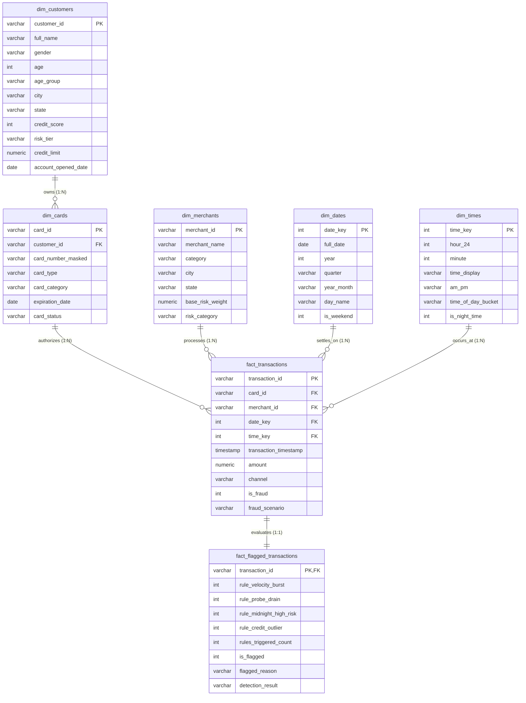

# Data Warehouse Star-Schema Architecture & Entity Relationships
**Project**: Credit Card Transaction and Fraud Pattern Analysis  
**Standard**: Kimball Star Schema / Dimensional Modeling  

---

## 1. Dimensional Model Overview

The financial warehouse is structured as a dimensional Star Schema separating numeric business events (`fact_transactions`, `fact_flagged_transactions`) from descriptive business contexts (`dim_customers`, `dim_cards`, `dim_merchants`, `dim_dates`, `dim_times`).

---

## 2. Grain & Design Principles

1. **Fact Table Grain**: Exactly one row per financial debit authorization event.
2. **Surrogate Keys**: Integer `date_key` (YYYYMMDD) and `time_key` (HHMM) allow index-based partitioning and joins without expensive runtime string parsing.
3. **Slowly Changing Dimensions (SCD)**:
   - `dim_customers`: Implemented as SCD Type 1 (Current view) with credit limit and risk tier tracking.
   - `dim_cards`: Maps card lifecycle (Active, Suspended, Closed).
4. **Referential Integrity**: 100% of foreign keys are enforced by database schema constraints.
